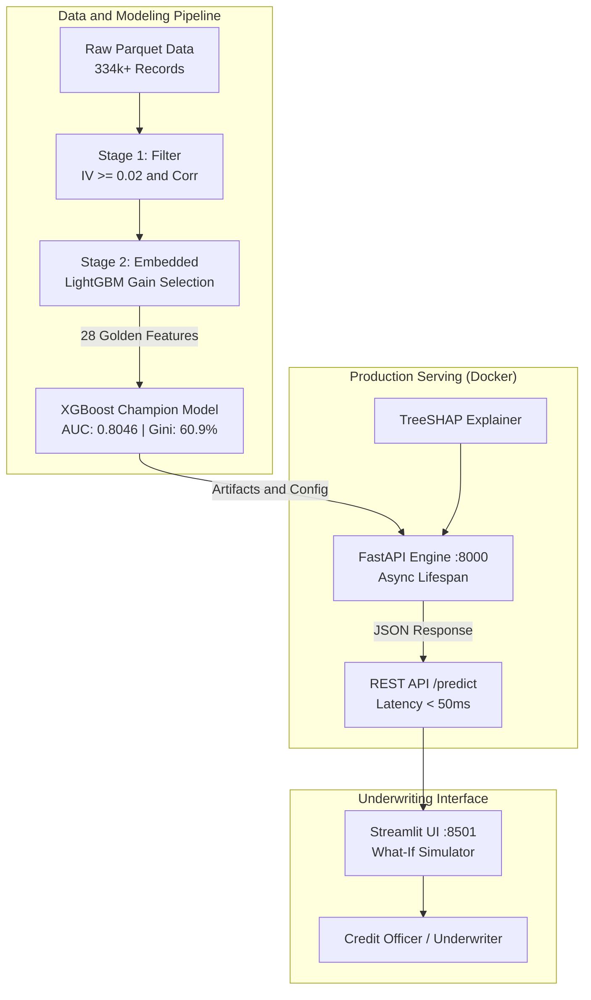
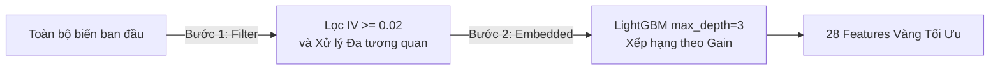

# 🏦 Explainable Credit Scoring System (XAI)

[](https://www.python.org/)
[](https://fastapi.tiangolo.com/)
[](https://xgboost.readthedocs.io/)
[](https://shap.readthedocs.io/)
[](https://streamlit.io/)
[](https://www.docker.com/)
[](https://opensource.org/licenses/MIT)
[](https://github.com/VUCONGHIEP35/explainable-credit-scoring/actions)

> Hệ thống chấm điểm tín dụng thời gian thực (Real-time Credit Risk Scoring) dành cho khách hàng cá nhân và nhóm khách hàng dưới chuẩn (Unbanked). Tích hợp **Explainable AI (TreeSHAP)** để mở hộp đen thuật toán, giải thích minh bạch quyết định phê duyệt hoặc từ chối theo chuẩn quản trị rủi ro ngân hàng.

---

## 📌 Table of Contents
- [1. Business Overview & Impact](#1-business-overview--impact)
- [2. System Architecture](#2-system-architecture)
- [3. Feature Selection Pipeline (2-Stage Filtering)](#3-feature-selection-pipeline-2-stage-filtering)
- [4. Model Benchmarking & Performance](#4-model-benchmarking--performance)
- [5. Explainable AI (XAI) with TreeSHAP](#5-explainable-ai-xai-with-treeshap)
- [6. MLOps & Production Architecture](#6-mlops--production-architecture)
- [7. Quickstart Guide](#7-quickstart-guide)
- [8. API Reference](#8-api-reference)
- [9. Project Structure](#9-project-structure)
- [10. License & Author](#10-license--author)

---

## 1. Business Overview & Impact

Trong lĩnh vực thẩm định tín dụng bán lẻ (Retail Banking / Consumer Lending), bài toán lớn nhất là đánh giá rủi ro cho nhóm khách hàng **Unbanked / Thin-file** (thiếu hoặc không có lịch sử tín dụng tại CIC). 

Mục tiêu của hệ thống:
- **Tối ưu hóa Phê duyệt:** Tự động hóa đánh giá hồ sơ vay dưới **100ms/request**.
- **Kiểm soát Nợ xấu (NPL):** Giảm thiểu tối đa tỷ lệ nợ nhóm 3, 4, 5 (theo chuẩn phân loại nợ của Ngân hàng Nhà nước).
- **Minh bạch theo Luật định (Regulatory Compliance):** Cung cấp lý do cụ thể tại sao hồ sơ bị từ chối (**Red Flags**) hoặc được phê duyệt (**Green Flags**) bằng phương pháp **SHAP (Shapley Additive exPlanations)**.

---

## 2. System Architecture

Hệ thống được thiết kế theo kiến trúc Microservices hiện đại, phân tách rõ ràng giữa Core Inference Engine và Presentation Layer:



---

## 3. Feature Selection Pipeline (2-Stage Filtering)

Từ hàng trăm trường thông tin hành vi và thanh toán ban đầu, hệ thống áp dụng quy trình tinh lọc 2 bước chặt chẽ:



1. **Bước 1 (Filter Method - Information Value & Correlation):**
   - Tính toán chỉ số **IV** (Information Value) cho từng biến. Loại bỏ các biến có **IV < 0.02** (không có lực phân tách rủi ro).
   - Lập ma trận tương quan Pearson/Spearman. Với các cặp biến có tương quan cao (**|r| > 0.7**), sử dụng IV làm trọng tài để giữ lại biến có năng lực dự báo cao hơn.
2. **Bước 2 (Embedded Method - Shallow Tree Gain):**
   - Đưa các biến sạch vào mô hình **LightGBM nông** (`max_depth=3`) để đánh giá độ quan trọng (Feature Importance) theo Gain.
   - Trích xuất chính xác **28 đặc trưng vàng** có đóng góp tích cực và bền vững nhất cho mô hình.

---

## 4. Model Benchmarking & Performance

Mô hình được kiểm chứng nghiêm ngặt trên tập **Out-Of-Time / Test Set độc lập** (không tham gia huấn luyện):

| Mô hình / Baseline | Kỹ thuật / Mô tả | AUC-ROC | Gini Index | Kolmogorov-Smirnov (KS) | Ghi chú |
| :--- | :--- | :---: | :---: | :---: | :--- |
| **Random Guess** | Dự đoán ngẫu nhiên | 0.5000 | 0.0000 | 0.0000 | Mốc chuẩn sàn |
| **Single Feature** | Dựa trên `pctinstlsallpaidlat10d` | 0.5749 | 0.1498 | 0.1210 | Biến đơn lẻ tốt nhất |
| **Logistic Regression** | Baseline tuyến tính chuẩn mực (L1/Lasso) | 0.7679 | 0.5358 | 0.4012 | Chuẩn ngành truyền thống |
| **🏆 XGBoost Champion** | **Mô hình phi tuyến cốt lõi + TreeSHAP** | **0.8046** | **0.6093** | **0.4644** | **Cải thiện +4.78% so với Linear** |

> **Nhận xét chuyên môn:** XGBoost vượt trội hơn mô hình Logistic Regression truyền thống nhờ khả năng học được các mối tương tác phi tuyến tính phức tạp (Non-linear Interactions) giữa lịch sử trả nợ quá hạn và khối lượng nợ thực tế.

---

## 5. Explainable AI (XAI) with TreeSHAP

Thay vì coi mô hình như một "hộp đen" (Black Box), hệ thống tích hợp **TreeSHAP** để giải thích cả cấp độ vĩ mô lẫn vi mô:

### 5.1. Global Explainability (Tổng quan dữ liệu)
- **Hành vi tích cực giảm rủi ro:** Số kỳ thanh toán đúng hạn trong quá khứ (`numinstlsallpaid`), lịch sử trả nợ trước hạn (`amtinstpaidbefduel24m`).
- **Hành vi tiêu cực tăng rủi ro:** Tỷ lệ kỳ trả chậm quá 10 ngày (`pctinstlsallpaidlat10d`), số ngày quá hạn lớn nhất trong 24 tháng (`maxdpdlast24m`), tổng nợ hiện tại (`totaldebt`).

### 5.2. Local Explainability (Từng khách hàng cụ thể)
Khi API chấm điểm một hồ sơ, TreeSHAP bóc tách thành **Red Flags** và **Green Flags**:

```json
{
  "status": "success",
  "prediction": {
    "default_probability": 0.8421,
    "decision": "REJECT"
  },
  "explanations": {
    "top_red_flags": [
      {
        "feature": "pctinstlsallpaidlat10d_839L",
        "value": 0.35,
        "impact": 0.4128
      },
      {
        "feature": "totaldebt_9A",
        "value": 150000.0,
        "impact": 0.2851
      }
    ],
    "top_green_flags": [
      {
        "feature": "numinstlsallpaid_934L",
        "value": 48.0,
        "impact": -0.1245
      }
    ]
  }
}
```

---

## 6. MLOps & Production Architecture

- **FastAPI Lifespan Context:** Nạp trước model artifacts và khởi tạo `TreeExplainer` vào RAM khi khởi động server, loại bỏ overhead I/O trong quá trình inference.
- **Champion / Challenger Framework:** Điều khiển qua `model_artifacts/config.json`. Cho phép chuyển đổi mô hình đang chạy hoặc thay đổi ngưỡng cắt rủi ro (`threshold_high_risk`) mà không cần sửa code.
- **Microservices Orchestration:** Đóng gói độc lập Backend (FastAPI) và Frontend (Streamlit) với Docker và Docker Compose.
- **Continuous Integration (CI):** Tự động kiểm thử toàn bộ API endpoints và data contract thông qua GitHub Actions trên mỗi commit.

---

## 7. Quickstart Guide

### Cách 1: Khởi chạy nhanh bằng Docker Compose (Khuyên dùng)
Yêu cầu: Máy đã cài đặt [Docker](https://www.docker.com/) & Docker Compose.

```bash
# 1. Clone repository
git clone https://github.com/VUCONGHIEP35/explainable-credit-scoring.git
cd explainable-credit-scoring

# 2. Khởi chạy toàn bộ hệ thống (API + UI) chỉ với 1 lệnh
docker compose up -d --build
```

- **Swagger API Documentation:** [http://localhost:8000/docs](http://localhost:8000/docs)
- **Giao diện Streamlit UI:** [http://localhost:8501](http://localhost:8501)

Để dừng dịch vụ:
```bash
docker compose down
```

---

### Cách 2: Chạy trực tiếp trên máy Local

```bash
# 1. Tạo và kích hoạt môi trường ảo Python
python -m venv .venv
# Trên Windows:
.venv\Scripts\activate
# Trên macOS / Linux:
source .venv/bin/activate

# 2. Cài đặt các thư viện cần thiết
pip install -r requirements.txt

# 3. Chạy FastAPI Server
uvicorn api.main:app --host 0.0.0.0 --port 8000 --reload

# 4. Mở thêm terminal khác và chạy Streamlit UI
streamlit run src/app_ui.py --server.port 8501
```

---

### Cách 3: Chạy Kiểm Thử Tự Động (Unit Tests)

```bash
# Chạy với pytest:
pytest -v tests/

# Hoặc chạy với unittest chuẩn:
python -m unittest tests/test_api.py
```

---

## 8. API Reference

### `GET /health`
Kiểm tra tình trạng hoạt động và trạng thái nạp mô hình vào bộ nhớ.

**Response (200 OK):**
```json
{
  "status": "healthy",
  "active_model": "xgboost_core",
  "version": "1.0",
  "features_loaded": 28
}
```

### `POST /predict`
Dự báo xác suất rủi ro vỡ nợ và phân tích SHAP.

**Request Body Example:**
Truy cập [http://localhost:8000/docs](http://localhost:8000/docs) → bấm **Try it out** → bấm **Execute** để chạy ngay với dữ liệu 28 biến mẫu điền sẵn.

---

## 9. Project Structure

```text
explainable-credit-scoring/
├── .github/
│   └── workflows/
│       └── ci.yml               # GitHub Actions CI workflow
├── api/
│   ├── __init__.py
│   └── main.py                  # FastAPI Server với Lifespan & XAI
├── model_artifacts/
│   ├── config.json              # Champion/Challenger Metadata & Thresholds
│   ├── selected_features.json   # Danh sách 28 Golden Features
│   ├── lr_baseline_model.joblib # Mô hình Logistic Regression đối chứng
│   └── xgboost_core_model.json  # Mô hình XGBoost Champion
├── notebooks/
│   ├── 01_eda.ipynb             # Phân tích khám phá dữ liệu (EDA)
│   ├── 02_feature_engineering.ipynb
│   ├── 03_feature_selection.ipynb   # Lọc biến bằng IV & LightGBM Gain
│   └── 04_modeling.ipynb        # Huấn luyện, đánh giá & SHAP Explainability
├── src/
│   └── app_ui.py                # Streamlit Web UI & What-If Simulator
├── tests/
│   └── test_api.py              # Bộ Unit Tests cho REST API
├── .dockerignore
├── .gitignore
├── docker-compose.yml           # Khởi chạy đồng thời API và Web UI
├── Dockerfile                   # Docker build cho FastAPI Backend
├── Dockerfile.ui                # Docker build cho Streamlit Frontend
├── LICENSE                      # Giấy phép MIT
├── README.md                    # Tài liệu dự án chi tiết
└── requirements.txt             # Danh mục thư viện phụ thuộc
```

---

## 10. License & Author

- **Tác giả:** [VU CONG HIEP](https://github.com/VUCONGHIEP35)
- **Mã nguồn:** [explainable-credit-scoring](https://github.com/VUCONGHIEP35/explainable-credit-scoring)
- **Giấy phép:** Được phát hành dưới giấy phép [MIT License](LICENSE).
